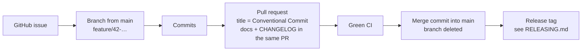

# Contributing to Logica

These rules apply to every change: code, documents and tooling. "Must" is a rule that CI or a
reviewer enforces; "should" is the expected default that a pull request may deviate from with a
stated reason. Releases, versions and the changelog are covered in [RELEASING.md](RELEASING.md).
The engineering rules (architecture, licence, clean room, definition of done) are in
[CLAUDE.md](CLAUDE.md) and the [documents](README.md#documents); this file is about how a change
reaches `main`.

Logica is an open-source project with **one maintainer** (decision D14,
[doc 12](docs/12-decisions-and-risks.md)).

## Contents

- [Workflow](#workflow)
- [Issues and milestones](#issues-and-milestones)
- [Branches](#branches)
- [Commits](#commits)
- [Size of changes](#size-of-changes)
- [Pull requests](#pull-requests)
- [Reviews](#reviews)
- [Definition of done](#definition-of-done)
- [AI-assisted changes](#ai-assisted-changes)
- [Repository settings](#repository-settings)

## Workflow



- `main` is the only long-lived branch. It must always build, pass CI and be releasable.
- Every change reaches `main` through a pull request (PR). Nobody pushes to `main` directly, and
  history on `main` is never rewritten.

## Issues and milestones

- Every `feature/` and `bugfix/` branch starts from a **GitHub issue** in this repository. The issue
  says what is wrong or missing and why it matters; the PR says how it was solved.
- Small changes without behaviour change (typos, wording, tooling, refactoring) may use an
  `improvement/` branch without an issue.
- **Milestones** are the releases: `v0.2.0` (M3, the DLA), `v0.3.0` (M4, FX2), `v0.4.0` (M5,
  formats and protocol depth), `v1.0.0` (M6) ([doc 11](docs/11-roadmap.md)). An issue belongs to
  the release it is planned for. Issues are written when the work starts, not all up front.
- Labels:

  | Label group | Values |
  |---|---|
  | `type:` | `feature`, `bug`, `improvement`, `security`, `docs`, `release` |
  | `area:` | `core`, `protocols`, `drivers`, `engine`, `fileio`, `mcp`, `node`, `cli`, `desktop`, `ui`, `api`, `vla`, `ops` |
  | Flags | `breaking`, `no-changelog`, `mechanical`, `needs-adr`, `needs-hardware` |

  The `area:` values are the crates and packages (`vla` is `tools/virtual-analyser`, `ops` is CI,
  release tooling and the repository itself). `needs-hardware` marks work that can only be
  verified with a real analyser.
- Security vulnerabilities are **never** reported in public issues; see [SECURITY.md](SECURITY.md).

## Branches

**Names** contain only lowercase letters, digits, `-` and `.`, plus one `/` after the prefix. The
description is 2–5 words in kebab case; the whole name is at most 60 characters.

| Prefix | Use | Example |
|---|---|---|
| `feature/<issue>-<desc>` | New or changed behaviour, including new design | `feature/42-dla-buffer-mode` |
| `bugfix/<issue>-<desc>` | Fix of a defect | `bugfix/57-vcd-scope-names` |
| `improvement/<desc>` | Refactoring, documentation, tooling; no behaviour change | `improvement/release-rules` |
| `merge/<desc>` | Merging one long-lived branch into another, e.g. a release branch's changelog into `main` | `merge/release-0.2-into-main` |
| `tmp/<desc>` | Experiments and spikes; **never merged** | `tmp/s3-dla-usb` |
| `release/<major>.<minor>` | Maintenance branch for a patch release ([RELEASING.md](RELEASING.md#maintenance-branches)) | `release/0.2` |

`<issue>` is the number of the GitHub issue, any length. The patterns CI checks:

```
^(feature|bugfix)/[0-9]+-[a-z0-9]+([.-][a-z0-9]+)*$
^(improvement|merge)/[a-z0-9]+([.-][a-z0-9]+)*$
```

`release/<major>.<minor>` is only ever the base of a PR, never its head. Branches created by the
dependency bot (`dependabot/…`) are exempt. A PR from a `tmp/` branch fails CI, because `tmp/`
branches are never merged.

**Lifetime**

- Branch from the current `main`; a backport branches from its `release/<major>.<minor>`.
- Keep branches short-lived. Bring a long-running branch up to date with `main` regularly.
- Branches are deleted when their PR is merged or closed (GitHub does it automatically). A `tmp/`
  branch is deleted when its result is written down (a spike's result goes into its document).
- Force-pushing your own unmerged branch is fine; force-pushing `main` or `release/*` is never
  allowed.

## Commits

Commit messages follow [Conventional Commits 1.0.0](https://www.conventionalcommits.org/en/v1.0.0/):

```
<type>(<scope>)!: <subject>

<body: why the change is needed, wrapped at 72 columns>

<footers: Closes #42, BREAKING CHANGE: …, Co-Authored-By: …>
```

| Type | Use | In the changelog? |
|---|---|---|
| `feat` | New user-visible behaviour | Yes: Added or Changed |
| `fix` | Defect fix | Yes: Fixed (Security for vulnerabilities) |
| `perf` | Faster or leaner, same behaviour | If users notice |
| `refactor` | Code change without behaviour change | No |
| `docs` | Documents, comments, README | No, unless user documentation that ships changes |
| `test` | Tests only | No |
| `build` | Build system, dependencies (`build(deps): …`) | Only if users are affected |
| `ci` | CI configuration | No |
| `chore` | Maintenance, release preparation (`chore(release): v0.2.0`) | No |
| `revert` | Reverts an earlier commit (`revert: feat(drivers): …`) | If the reverted change was released |

- **Scope** is optional and is one of the `area:` label values (`engine`, `desktop`, `drivers`, …),
  or `adr`, `deps`, `release`.
- **Subject**: imperative mood ("add", not "added"), lowercase start, no trailing period, English.
  The whole first line is at most **72 characters**. The dependency bot's commits and titles are
  exempt from the lowercase start and the length.
- **Body**: explains *why*; the diff shows *what*. Required for `feat`, `fix` and anything
  non-obvious.
- **Breaking changes** add `!` after the type or scope **and** a `BREAKING CHANGE:` footer that
  says what users must do. See [RELEASING.md](RELEASING.md#versioning) for what counts as breaking.
- **Issue references** go into footers: `Closes #42` when the change resolves the issue,
  `Refs #42` otherwise.
- Every commit leaves the tree buildable; nothing is committed that the commit then fixes.
  Fix-ups made during review are folded into the commit they fix before merging
  (`git commit --fixup <commit>`, then `git rebase --autosquash main`); CI refuses `fixup!`
  commits.
- Never commit secrets, credentials, build output or FNIRSI's example captures (doc 10).
  Generated files are committed where the repository needs them (the command API contract and
  its TypeScript types, see CLAUDE.md, "Commands") and are regenerated in the same PR.

PRs are merged with a **merge commit**, so every commit of the branch reaches `main` unchanged.
These rules therefore apply to each commit, not only to the PR title, and CI checks every commit
header. Commits made before these rules (sentence-style subjects, up to PR #10) stay as they are.

## Size of changes

One PR is **one logical change**, and becomes one merge commit on `main`. Small changes are
reviewed better, reverted more safely and released more predictably.

| Kind of change | Guidance |
|---|---|
| Production code (excluding tests, benchmarks, examples, generated files, fixtures and lockfiles) | **Should** stay below 400 changed lines. 400–800 lines: the description says why it cannot be split. Above 800 lines: split it, unless the change is mechanical (rename, move, generated) |
| Tests | No limit; tests for a change belong in the same PR |
| Documents | One feature or one decision per PR |
| Dependency updates | One dependency, or one bot-grouped set, per PR |

CI counts the production lines of every PR and **warns** from 400 lines; it does not fail a PR on
size before v1.0.0 (decision D14). The label `mechanical` silences the warning. Rust tests inside
a source file (`#[cfg(test)]`) are counted as production code, because the count goes by file.

How to split:

- **Separate refactoring from behaviour change.** First a `refactor` PR that changes no behaviour,
  then the `feat` or `fix` PR on top.
- **Separate mechanical changes** (renames, moves, formatting) from everything else.
- **Slice features vertically or by layer** (engine command → MCP tool → window), each slice merged
  on its own and kept inert until the feature is complete: not reachable from the window or MCP,
  or behind a setting that defaults to off. `main` must stay releasable at every merge. An inert
  slice carries `no-changelog`; the PR that makes the feature reachable writes its CHANGELOG
  entry.
- Stacked PRs (a branch based on another open branch) are allowed; retarget them to `main` after
  the base merges.

## Pull requests

- **Title** is a Conventional Commit header, at most 72 characters; the merge commit records it.
  CI checks it.
- **Description** follows the [PR template](.github/pull_request_template.md): what and why, the
  issue, how it was tested, what was not verified, breaking changes and upgrade notes.
- Documents and the [CHANGELOG](RELEASING.md#changelog) entry are part of the **same** PR as the
  change, never a follow-up. A PR without a user-visible change gets the `no-changelog` label.
- Open a **draft** PR early for feedback on direction; mark it ready when it meets the
  [Definition of done](#definition-of-done).
- Before merging, the branch must be up to date with `main` and CI must be green.
- **Merge method: merge commit** ("Create a merge commit", GitHub's default). The branch's commits
  reach `main` unchanged, with their `Closes #…`, `BREAKING CHANGE:` and `Co-Authored-By:`
  footers; the merge commit keeps GitHub's default message (`Merge pull request #N from …`, with
  the PR title as its body). Squash and rebase merges stay enabled, as in GitHub's default
  settings, but are not used: a squash merge drops the branch's commits, and a rebase merge
  rewrites them.
- The **author merges** once CI is green; for an external contribution the maintainer merges. The
  branch is deleted automatically; its commits stay reachable from the merge commit.
- Reverting is a new PR (`revert: …`) through the same process; it reverts the merge commit
  (`git revert -m 1 <merge commit>`).

## Reviews

Logica has one maintainer, and GitHub does not let an author approve their own pull request. The
**merge gate is therefore the pull request plus green CI; no approval is required** (decision
D14).

- Before marking a PR ready, the author reviews the whole diff for: correctness including error
  paths, tests, documents and CHANGELOG, and the size guidance. An AI code review may be used at
  the author's discretion; it is not required and does not replace the author's own review.
- **External contributions** are reviewed by the maintainer. Prefix optional suggestions with
  `nit:`; they do not block merging.
- **If further maintainers join**, this section changes by PR to: at least one approval from a
  maintainer other than the author.

## Definition of done

A change is done when:

- [ ] The checks of [CLAUDE.md](CLAUDE.md#definition-of-done) are clean: `cargo fmt --check`,
      `cargo clippy --all-targets -- -D warnings`, `cargo test`, `npm run build`,
      `npm run lint`, `npm test`.
- [ ] New or changed behaviour has tests that cover **error cases and edge conditions** (invalid
      input, boundary values, failure paths), not only the happy path
      ([doc 10](docs/10-testing-and-quality.md)).
- [ ] The documents say what the code does, changed in the same PR.
- [ ] The CHANGELOG has an entry under `Unreleased`, or the PR is labelled `no-changelog`.
- [ ] Breaking changes are marked and come with upgrade notes.
- [ ] The PR description says what was verified by tests, what only by eye, and what could not be
      run (for example "needs real hardware").
- [ ] CI is green.

## AI-assisted changes

- AI-written code and text are reviewed and tested like any other change. The person who opens
  the PR is responsible for every line.
- Commits with substantial AI-written content carry a `Co-Authored-By:` footer naming the
  assistant; PR descriptions written with an assistant say so.
- AI assistants never force-push and never delete a remote branch: they bring a pushed branch up
  to date by merging `main` into it, and leave deletions to the maintainer.
- Assistants run the fast checks of what they changed before the first push. **Until v1.0.0** a
  defect CI then finds is fixed by a further commit on the pushed branch, which stays a commit of
  its own and builds.
- An assistant whose PR adds or renames a CI job updates the required checks in
  `.github/repo-settings.mjs`; the maintainer runs it ([Repository settings](#repository-settings)).
- [CLAUDE.md](CLAUDE.md) at the repository root summarises these rules for AI coding assistants.
  It changes in the same PR as the rules it summarises. Personal assistant settings stay out of the
  repository.

## Repository settings

The repository is `github.com/felix-homelab/logica-rust` (decision D5). The maintainer configures
GitHub so that the rules above are enforced, not just written down;
`node .github/repo-settings.mjs` shows what differs and `--apply` applies it
([`.github/repo-settings.mjs`](.github/repo-settings.mjs)):

- **`main` ruleset:** pull request required, with **no required approval** ([Reviews](#reviews));
  conversations resolved; branch up to date before merge; force pushes and deletion blocked;
  required status checks: `pr-rules` and every job of the CI workflow (repository checks, Rust on
  Linux, WebAssembly, Rust tests on Windows and macOS, npm, the desktop app on Linux and Windows).
  There is no CODEOWNERS file, and no linear-history rule, because PRs are merged with merge
  commits.
- **`release/*` ruleset:** the same as `main`.
- **Tag ruleset for `v*`:** only the maintainer creates tags; tags cannot be updated or deleted.
- **Merge settings:** GitHub's defaults: merge commits, squash and rebase merges allowed, the
  default merge commit message; merge commits are the method used ([Pull requests](#pull-requests)).
  Head branches are deleted automatically.
- **Security:** private vulnerability reporting enabled; secret scanning and push protection on.
- **CI and dependencies:** GitHub Actions, pinned to commit SHAs with the version as a comment;
  Dependabot for Cargo, npm and GitHub Actions (`.github/dependabot.yml`).
- **Labels and milestones** as in [Issues and milestones](#issues-and-milestones).

A CI job that is renamed or added changes the check names: the same PR updates
`repo-settings.mjs`, and the maintainer runs it after the merge.
