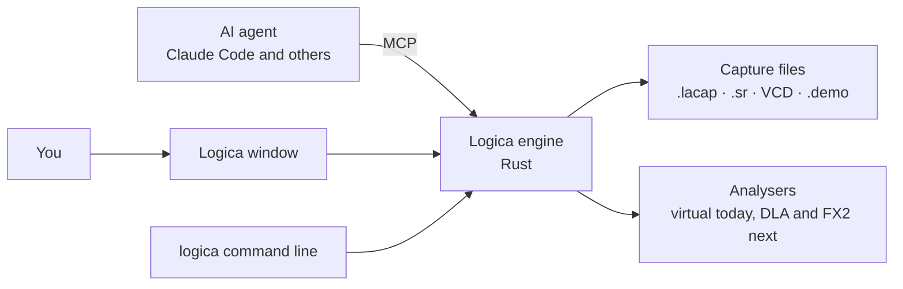

# Logica — a logic analyser you and your AI agent use together

**An open-source desktop logic analyser and protocol decoder for Windows, macOS and Linux, with a
built-in MCP server so agents such as Claude Code can capture, decode and explain signals with
you.**

Logica opens captures from other tools, decodes UART, SPI, I²C, CAN and more, finds the protocols
on its own and explains in plain words why it thinks so. An AI agent connected over the
[Model Context Protocol](https://modelcontextprotocol.io) works in the same session as you: it can
open a capture, add decoders, search, measure and mark what it found, and you see it happen live in
the window. Real hardware support starts with the FNIRSI DLA-32 Plus / DLA-16 Plus and cheap
FX2-based analysers.

> [!NOTE]
> Logica is young. The first release, v0.1.0, is being prepared: it works with capture files and
> with the [virtual analyser](#try-it-without-hardware); capturing from real hardware comes with
> v0.2.0 ([roadmap](#roadmap)). Until the release is out,
> [build it from source](#build-from-source). Ideas and bug reports are welcome in the
> [issues](https://github.com/felix-homelab/logica-rust/issues).

## Why Logica

- **Built for agents, not just scriptable.** Anything you can do in the window, an agent can do
  too. Ask your agent to "capture the I²C bus and check that register 0x20 was written with 0x57"
  and watch it happen in the same view.
- **Explains, not only decodes.** Logica groups channels into buses, detects protocols with
  plain-language evidence, and says why a decode looks wrong.
- **Open to other tools' files.** sigrok/PulseView `.sr`, VCD from simulators and FNIRSI `.demo`
  files open in one interface; Saleae exports follow.
- **Hardware that lacks good open software.** First-class support for the FNIRSI DLA-32 Plus /
  DLA-16 Plus comes next, then cheap FX2 clones.
- **One modern desktop app.** One installer gives the viewer, the decoders, the MCP server and the
  `logica` command line. No browser and no separate server to start.

## How it works



The window, the command line and every connected agent share one engine, so they all see the
same captures, decoders and markers. Everything an agent does shows in the activity feed and can
be undone, and **Stop agent actions** pauses it at once.

## Features

What works today:

| Area | What you get |
|---|---|
| **Protocol decoders** | UART, SPI, I²C, I²S, CAN, JTAG, SWD and PWM; NEC infrared, DHT sensors, WS2812 LEDs and 1-Wire; your own protocols described as JSON |
| **Detection and analysis** | Automatic protocol detection with evidence, bus grouping, measurements (frequency, period, duty cycle, pulse widths), a byte analyser |
| **Viewing** | A fast waveform even for very long captures, cursors, selection, markers, decoded data as text under the frames, a decoded table, search, a command palette, light and dark themes |
| **Files** | Opens FNIRSI `.demo`, sigrok `.sr` and VCD; saves `.lacap`, a single-file format with recovery from an interrupted save; file associations and drag and drop |
| **Live capture** | Live capture and live decoding, from one device or several lined up in one capture; a virtual analyser to try it without hardware |
| **AI agents (MCP)** | Tools to open, capture, decode, search, measure, render a range as an image and point things out to you; connects through `logica mcp`, or over HTTP on your own machine only |
| **Command line** | `logica inspect`, `logica convert`, `logica open`, `logica mcp` |
| **Updates** | The app updates itself on Windows and Linux |

## Supported hardware and file formats

| | Today | Planned |
|---|---|---|
| **Analysers** | The virtual analyser (`logica-vla`) | FNIRSI DLA-32 Plus / DLA-16 Plus (v0.2.0), FX2 / fx2lafw analysers (v0.3.0); Saleae devices through Saleae's automation API after 1.0 |
| **Open** | `.lacap`, FNIRSI `.demo`, sigrok `.sr`, VCD | Saleae binary export and `.sal` (v0.4.0) |
| **Save and export** | `.lacap` | `.sr`, VCD, CSV, decoded packets (v0.4.0) |

## Install

Installers for every release are on the
[Releases page](https://github.com/felix-homelab/logica-rust/releases): an installer for Windows,
an AppImage for Linux and a disk image for macOS. They are not code-signed yet, so your system
asks once whether you trust them:

- **Windows:** when SmartScreen says "Windows protected your PC", choose **More info** →
  **Run anyway**.
- **macOS:** open the app once, then allow it under **System Settings** → **Privacy & Security** →
  **Open Anyway**. macOS does not update the app by itself; download new releases yourself.
- **Linux:** make the AppImage executable (`chmod +x Logica-*.AppImage`) and start it.

The release page also lists the standalone `logica` command-line tool for each system and
`SHA256SUMS` to check the downloads. What changed in each release is in the
[changelog](CHANGELOG.md).

## Use it with Claude Code

1. Install Logica and start it once, so `logica mcp` knows where the app is.
2. Put the `logica` command on your PATH: download it from the release, or use the copy that
   ships with the app (in the installation's `resources/bin` folder).
3. Add Logica to Claude Code:

   ```sh
   claude mcp add logica -- logica mcp
   ```

   With Claude Code in WSL and Logica on Windows, point it at the Windows binary:
   `claude mcp add logica -- /mnt/c/…/resources/bin/logica.exe mcp`.

4. Ask, for example: *"Open ~/captures/board.sr, find the buses, decode them and tell me what the
   microcontroller sends to the sensor."*

`logica mcp` connects to the running app, starts it (minimised) when it is not running, or runs a
windowless engine with `--headless`, for CI. Any MCP client that can start a stdio server works
the same way. Details: [MCP server](docs/07-mcp-server.md).

## Try it without hardware

The virtual analyser behaves like a streaming logic analyser and generates UART, I²C, SPI, PWM,
clocks and noise. From a source checkout:

```sh
cargo run -p logica-vla
```

Then choose **Capture live** in Logica. Signals, rates and channels are configurable:
[tools/virtual-analyser](tools/virtual-analyser/README.md).

## Command line

```sh
logica inspect capture.sr            # what a capture holds; --json for the full summary
logica convert capture.vcd out.lacap # any format Logica reads to .lacap
logica open out.lacap                # open it in the app
logica mcp                           # MCP over stdio for an agent
```

## Build from source

You need [Rust](https://rustup.rs) through rustup and [Node.js](https://nodejs.org) 24 or newer.

```sh
git clone https://github.com/felix-homelab/logica-rust.git
cd logica-rust
rustup toolchain install     # the Rust version pinned in rust-toolchain.toml
npm install
npm run build                # the engine, the command line and the window
npm start                    # start the desktop app (the first run downloads Electron)
npm run package              # installers for this system, in apps/desktop/dist
```

`cargo test` and `npm test` run the tests.

## Roadmap

| Release | What it brings |
|---|---|
| v0.1.0 | Files, decoders, detection, MCP, the command line, the desktop app, live capture with the virtual analyser |
| v0.2.0 | FNIRSI DLA-32 Plus / DLA-16 Plus |
| v0.3.0 | FX2 / fx2lafw analysers |
| v0.4.0 | Saleae files, exports, deeper protocol support (layered decoders, register maps, comparing captures) |
| v1.0.0 | Install guides, user documentation, a setup guide for Claude Code |

What is done so far is in [docs/progress.md](docs/progress.md).

## Documentation

- [MCP server](docs/07-mcp-server.md): how agents connect, and the tools they get.
- [File formats](docs/09-file-formats.md): what Logica opens and saves, and the `.lacap` format.
- [Devices](docs/05-devices-and-drivers.md): the analysers Logica supports and how to set them up.
- [Virtual analyser](tools/virtual-analyser/README.md): signals for trying Logica without hardware.

How Logica is designed and built is described in the [docs](docs/) folder.

## Contributing and support

- Bugs and ideas: [open an issue](https://github.com/felix-homelab/logica-rust/issues).
- Code and documents: [CONTRIBUTING.md](CONTRIBUTING.md) says how a change gets in. Drivers and
  file importers are built from documented facts only, never from GPL or vendor code.
- Security vulnerabilities: report them privately, as [SECURITY.md](SECURITY.md) explains.

## License

Logica is open source under the [Apache License 2.0](LICENSE). The engine is written in Rust, the
window in TypeScript with React and Electron.
