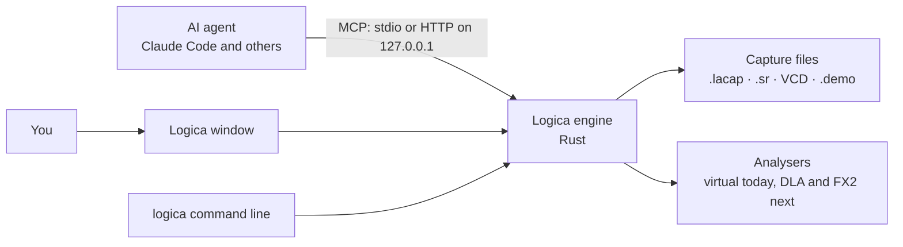

# Logica — a logic analyser you and your AI agent use together

**An open-source desktop logic analyser and protocol decoder for Windows, macOS and Linux, with a
built-in MCP server so agents such as Claude Code can capture, decode and explain signals with
you.**

Logica opens captures from other tools, decodes UART, SPI, I²C, CAN and more, finds the protocols
on its own and explains in plain words why it thinks so. An AI agent connected over the
[Model Context Protocol](https://modelcontextprotocol.io) works in the same session as you: it can
open a capture, add decoders, search, measure and mark what it found, and you see it happen live in
the window. Real hardware support starts with the FNIRSI DLA-32 Plus / DLA-16 Plus and cheap
FX2-based analysers.

> [!NOTE]
> Logica is young. The first release, v0.1.0, is being prepared: it works with capture files and
> with the [virtual analyser](#try-it-without-hardware); capturing from real hardware comes with
> v0.2.0 ([roadmap](#roadmap)). Until the release is out,
> [build it from source](#build-from-source). Ideas and bug reports are welcome in the
> [issues](https://github.com/felix-homelab/logica-rust/issues).

## Why Logica

- **Built for agents, not just scriptable.** Every action in the app is a command, and the MCP
  server is a full client of the same commands. Ask your agent to "capture the I²C bus and check
  that register 0x20 was written with 0x57" while you watch it in the same view.
- **Explains, not only decodes.** Logica groups channels into buses, detects protocols with
  plain-language evidence, and says why a decode looks wrong.
- **Open to other tools' files.** sigrok/PulseView `.sr`, VCD from simulators and FNIRSI `.demo`
  files open in one interface; Saleae exports follow.
- **Hardware that lacks good open software.** First-class support for the FNIRSI DLA-32 Plus /
  DLA-16 Plus is the next milestone, then FX2 clones.
- **One modern desktop app.** One installer gives the viewer, the decoders, the MCP server and the
  `logica` command line. No browser and no separate server to start.

## How it works



There is one engine per desktop. The window, the command line and every connected agent are
clients of it, so they all see the same captures, decoders and markers. Everything an agent does
shows in the activity feed, can be undone, and **Stop agent actions** pauses it at once.

## Features

What works today:

| Area | What you get |
|---|---|
| **Protocol decoders** | UART, SPI, I²C, I²S, CAN, JTAG, SWD and PWM; NEC infrared, DHT sensors, WS2812 LEDs and 1-Wire; your own protocols described as JSON |
| **Detection and analysis** | Automatic protocol detection with evidence, bus grouping, measurements (frequency, period, duty cycle, pulse widths), a byte analyser |
| **Viewing** | Waveform with level of detail for very long captures (past 2^32 samples), cursors, selection, markers, decoded data as text under the frames, a decoded table, search, a command palette, light and dark themes |
| **Files** | Opens FNIRSI `.demo`, sigrok `.sr` and VCD; saves `.lacap`, a single-file format with recovery from an interrupted save; file associations and drag and drop |
| **Live capture** | Live capture and live decoding, from one device or several lined up in one capture; a virtual analyser to try it without hardware |
| **AI agents (MCP)** | Tools to open, capture, decode, search, measure, render a range as an image and point things out to you; stdio through `logica mcp`, or HTTP on 127.0.0.1 with a token |
| **Command line** | `logica inspect`, `logica convert`, `logica open`, `logica mcp` |
| **Updates** | The app updates itself on Windows and Linux |

## Supported hardware and file formats

| | Today | Planned |
|---|---|---|
| **Analysers** | The virtual analyser (`logica-vla`) | FNIRSI DLA-32 Plus / DLA-16 Plus (v0.2.0), FX2 / fx2lafw analysers (v0.3.0); Saleae devices through Saleae's automation API after 1.0 |
| **Open** | `.lacap`, FNIRSI `.demo`, sigrok `.sr`, VCD | Saleae binary export and `.sal` (v0.4.0) |
| **Save and export** | `.lacap` | `.sr`, VCD, CSV, decoded packets (v0.4.0) |

## Install

Installers for every release are on the
[Releases page](https://github.com/felix-homelab/logica-rust/releases): an installer for Windows,
an AppImage for Linux and a disk image for macOS. They are not code-signed yet, so your system
asks once whether you trust them:

- **Windows:** when SmartScreen says "Windows protected your PC", choose **More info** →
  **Run anyway**.
- **macOS:** open the app once, then allow it under **System Settings** → **Privacy & Security** →
  **Open Anyway**. macOS does not update the app by itself; download new releases yourself.
- **Linux:** make the AppImage executable (`chmod +x Logica-*.AppImage`) and start it.

The release page also lists the standalone `logica` command-line tool for each system and
`SHA256SUMS` to check the downloads. What changed in each release is in the
[changelog](CHANGELOG.md).

## Use it with Claude Code

1. Install Logica and start it once, so `logica mcp` knows where the app is.
2. Put the `logica` command on your PATH: download it from the release, or use the copy that
   ships with the app (in the installation's `resources/bin` folder).
3. Add Logica to Claude Code:

   ```sh
   claude mcp add logica -- logica mcp
   ```

   With Claude Code in WSL and Logica on Windows, point it at the Windows binary:
   `claude mcp add logica -- /mnt/c/…/resources/bin/logica.exe mcp`.

4. Ask, for example: *"Open ~/captures/board.sr, find the buses, decode them and tell me what the
   microcontroller sends to the sensor."*

`logica mcp` connects to the running app, starts it (minimised) when it is not running, or runs a
windowless engine with `--headless`, for CI. Any MCP client that can start a stdio server works
the same way. Details: [MCP server](docs/07-mcp-server.md).

## Try it without hardware

The virtual analyser behaves like a streaming logic analyser and generates UART, I²C, SPI, PWM,
clocks and noise. From a source checkout:

```sh
cargo run -p logica-vla
```

Then choose **Capture live** in Logica. Signals, rates and channels are configurable:
[tools/virtual-analyser](tools/virtual-analyser/README.md).

## Command line

```sh
logica inspect capture.sr            # what a capture holds; --json for the full summary
logica convert capture.vcd out.lacap # any format Logica reads to .lacap
logica open out.lacap                # open it in the app
logica mcp                           # MCP over stdio for an agent
```

## Build from source

You need [Rust](https://rustup.rs) through rustup and [Node.js](https://nodejs.org) 24 or newer.

```sh
git clone https://github.com/felix-homelab/logica-rust.git
cd logica-rust
rustup toolchain install     # the Rust version pinned in rust-toolchain.toml
npm install
npm run build                # the engine, the command line and the window
npm start                    # start the desktop app (the first run downloads Electron)
npm run package              # installers for this system, in apps/desktop/dist
```

`cargo test` and `npm test` run the tests. The full list of commands is in
[CLAUDE.md](CLAUDE.md#commands).

## Roadmap

| Release | Milestone | What it brings |
|---|---|---|
| v0.1.0 | M0–M2 | Files, decoders, detection, MCP, the command line, the desktop app, live capture with the virtual analyser |
| v0.2.0 | M3 | FNIRSI DLA-32 Plus / DLA-16 Plus |
| v0.3.0 | M4 | FX2 / fx2lafw analysers |
| v0.4.0 | M5 | Saleae files, exports, protocol depth (layer decoders, register maps, capture comparison) |
| v1.0.0 | M6 | Install guides, user documentation, the Claude Code setup guide |

Progress is tracked in [docs/progress.md](docs/progress.md), the plan in
[docs/11-roadmap.md](docs/11-roadmap.md).

## Design documents

The documents are the plan: they say what Logica does and why, before the code does it.

| # | Document | What it settles |
|---|---|---|
| 01 | [Vision and scope](docs/01-vision-and-scope.md) | Who it is for, what it does, what it deliberately does not do |
| 02 | [Feasibility and constraints](docs/02-feasibility-and-constraints.md) | What USB, operating systems, vendors and licences allow; verdict per feature, with sources |
| 03 | [Architecture](docs/03-architecture.md) | One engine and its clients, processes, repository layout, the command API |
| 04 | [Data model and storage](docs/04-data-model-and-storage.md) | Chunked transition storage, level of detail, very large captures, ingest |
| 05 | [Devices and drivers](docs/05-devices-and-drivers.md) | Driver and transport interfaces, plan per device, setup help, safety |
| 06 | [Protocol engine](docs/06-protocol-engine.md) | Streaming decoders, detection, stacking, register maps, queries, custom protocols |
| 07 | [MCP server](docs/07-mcp-server.md) | Transports, security, tools, resources, prompts |
| 08 | [User interface](docs/08-ui.md) | Desktop look, layout, panels, performance budgets, accessibility |
| 09 | [File formats](docs/09-file-formats.md) | Import and export, and the `.lacap` specification |
| 10 | [Testing and quality](docs/10-testing-and-quality.md) | Definition of done, test layers, fixtures, replay testing, CI |
| 11 | [Roadmap](docs/11-roadmap.md) | Spikes and milestones with exit criteria |
| 12 | [Decisions and risks](docs/12-decisions-and-risks.md) | What the owner decided, and what could go wrong |
| — | [Clean-room rule](docs/clean-room.md) | Which sources drivers and importers may be built from |
| — | [Benchmarks](docs/benchmarks.md) | Measured numbers and the baseline to beat |
| ADR | [Architecture decision records](docs/adr/) | The few decisions that are expensive to reverse |

## Contributing and support

- Bugs and ideas: [issues](https://github.com/felix-homelab/logica-rust/issues), with the bug and
  feature templates.
- Changes: [CONTRIBUTING.md](CONTRIBUTING.md) says how a change reaches `main`;
  [RELEASING.md](RELEASING.md) covers versions and releases.
- Security vulnerabilities: privately, as [SECURITY.md](SECURITY.md) says, never in a public
  issue.
- Drivers and file importers are written clean-room from documented facts only, never from GPL or
  vendor code ([docs/clean-room.md](docs/clean-room.md)).

## Where it comes from

Logica grew out of Signal Detective, the owner's learning tool for protocols: its detectors,
evidence texts and sample captures are the reference for Logica's protocol knowledge and its
acceptance tests, though none of its code is carried over (decision D12). A TypeScript prototype
tried the storage and decoding design first; its measured numbers are the baseline in
[docs/benchmarks.md](docs/benchmarks.md).

## License

Logica is open source under the [Apache License 2.0](LICENSE) (ADR 0009). The engine is written in
Rust, the window in TypeScript with React and Electron (ADR 0002).
